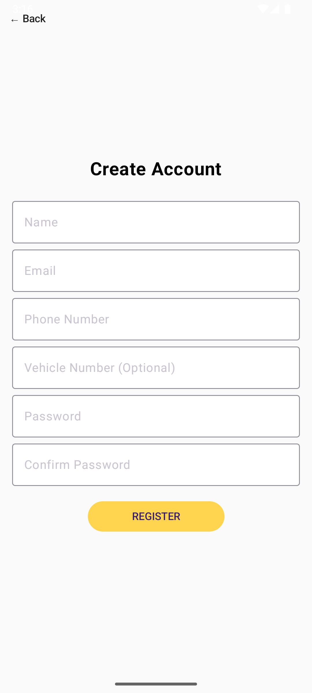
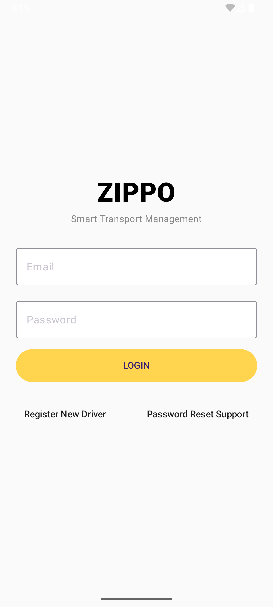
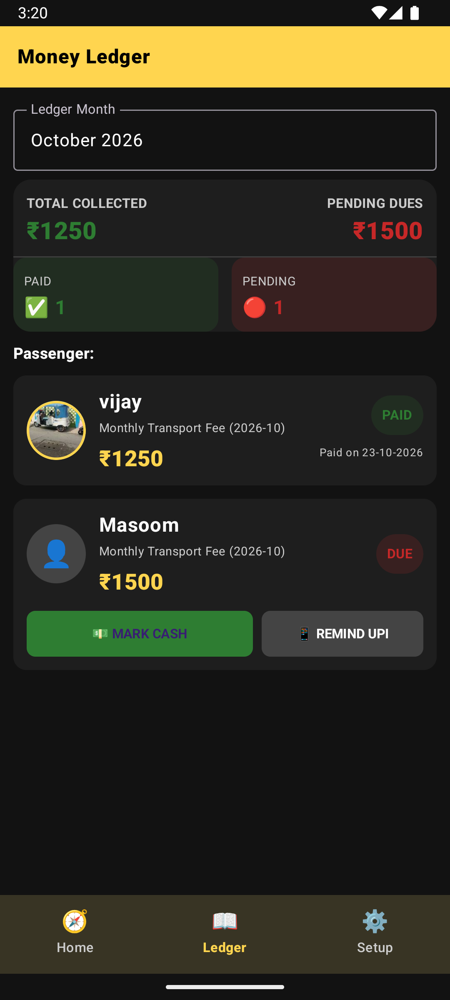
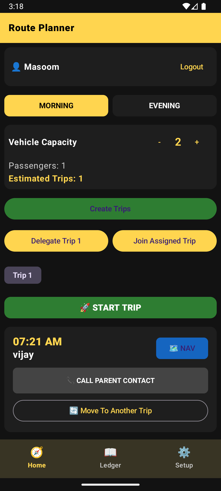
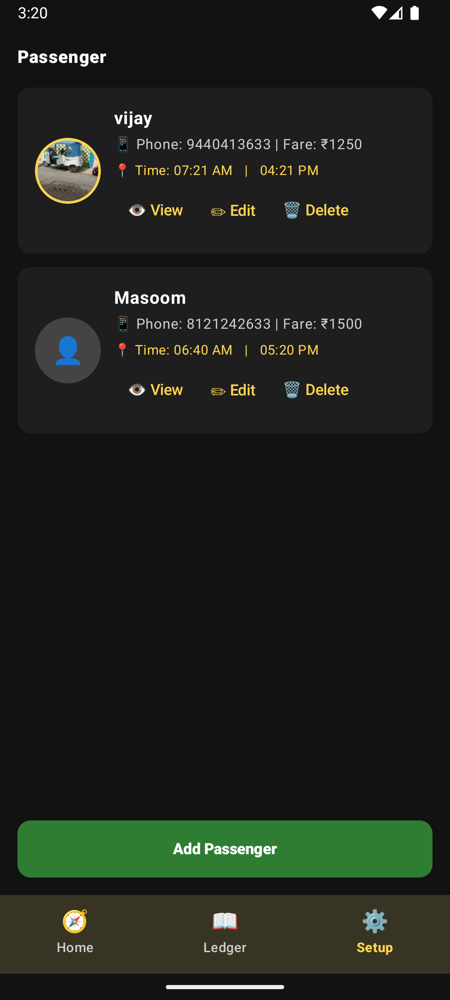
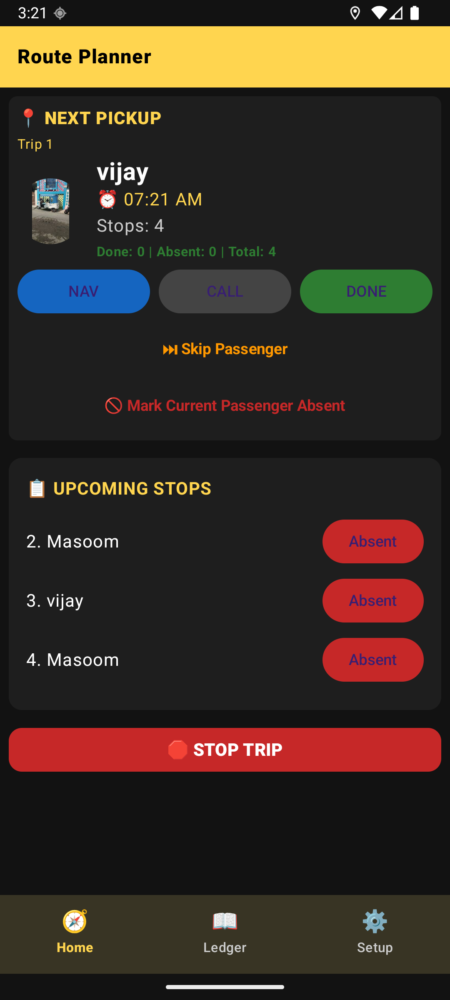

# 🛺 ZIPPO — Commuter Fleet & Route Management App

ZIPPO is a full-stack Android and backend application for independent auto-rickshaw, commuter-van, and school-bus drivers managing fixed pickup-and-drop routes for school children and corporate employees.

It helps drivers manage daily routes, passenger attendance, vehicle capacity, trip delegation, parent communication, holidays, subscriptions, and monthly payment ledgers from a single mobile application.

## 📲 Download APK

Download the latest Android build from the GitHub Releases page:

[Download ZIPPO v1.8.0 APK](https://github.com/alipm/zippo-app/releases#release-v1.8.0-radar-widget)

## 🎯 Problem It Solves

Drivers often manage recurring routes using handwritten notes, WhatsApp messages, and memory-based records. This can lead to:

- Missed or delayed subscription payments
- Manual route sequencing and repeated coordination
- Difficulty tracking morning and evening attendance separately
- Vehicle overloading during high-demand trips
- Time-consuming communication with parents and employees
- No clear history of monthly invoices and payments

ZIPPO digitises these workflows into a simple, mobile-first application.

## ✨ Key Features

### Route and Shift Management
- Separate morning and evening duty schedules
- Automatic reversal of pickup and drop locations based on the active shift
- Support for passengers with morning-only, evening-only, or both-shift contracts
- Dynamic route sequencing based on pickup and drop locations

### Attendance and Trip Management
- Independent attendance tracking for morning and evening shifts
- Passenger status management: pending, present, and absent
- Capacity-based automatic trip splitting
- Manual passenger movement between trips
- Capacity safeguards to prevent overloading
- Custom trip-size configuration for uneven passenger distribution

### Multi-Driver Trip Delegation
- Drivers can delegate selected trips to other registered drivers
- Unique trip assignment codes for secure delegation
- Delegated drivers receive only operational trip details
- Financial and billing data remain restricted to the original driver
- Permission-based access control for delegated trip data

### Location-Based Alerts
- Android foreground service for location tracking during active trips
- 1 km proximity detection for the next pickup or drop location
- In-app high-visibility alerts when approaching a passenger location
- One-tap WhatsApp deep link for pre-filled passenger communication
- One-tap native dialer integration for parent or employee contact

### Financial Ledger and Invoicing
- Monthly invoice generation for active passengers
- Invoice-based ledger architecture with historical payment records
- Soft-delete strategy to preserve past invoices and billing history
- Month-wise ledger dashboard and payment status tracking
- UPI transaction ID/UTR-based manual payment verification
- Parent/household grouping for siblings using the same pickup point

### Subscription and Access Control
- Six-month free trial for new drivers
- Monthly subscription model after the trial period
- UPI QR-based payment collection
- Admin verification of UPI transaction IDs/UTR numbers
- Subscription-based access control

## 🧰 Tech Stack

### Android Application
- Kotlin
- Jetpack Compose
- Android Foreground Services
- Location Services
- WhatsApp deep links
- Native dialer integration
- MVVM architecture

### Backend
- NestJS
- TypeScript
- MongoDB
- Mongoose
- REST APIs
- JWT authentication
- Azure Blob Storage
- Azure DevOps

## 📱 Screenshots

| Register | Login | App Icon
|---|---|---|
|   |  |  |

| Billing | Route Planner | Passenger Update | Trip Planner
|---|---|---|
|  |  |  | 

## 🗂️ Repository Structure

```text
zippo-app/
├── zippo-android/       # Android application - Kotlin and Jetpack Compose
├── zippo-backend/       # NestJS backend and MongoDB APIs
├── docs/                # Screenshots, architecture diagrams, and documentation
├── CONTEXT.md           # Technical architecture and development context
└── README.md
```

## 🚀 Getting Started

### Prerequisites

- Android Studio
- JDK 17+
- Node.js 18+
- MongoDB Atlas account or local MongoDB instance
- Android device or emulator

### Backend Setup

```bash
cd zippo-backend
npm install
cp .env.example .env
npm run start:dev
```

### Android Setup

```bash
cd zippo-android
```

1. Open the project in Android Studio.
2. Add the backend base URL in the appropriate configuration file.
3. Run the app on an Android device or emulator.

## 🔐 Environment Variables

Create a `.env` file in the backend folder using `.env.example` as a reference.

Do not commit real API keys, database credentials, JWT secrets, or cloud credentials.


## 🗺️ Roadmap

- [x] Morning and evening shift management
- [x] Passenger attendance tracking
- [x] Capacity-based trip splitting
- [x] Manual passenger swap between trips
- [x] Trip delegation with access control
- [x] Proximity-based alerts
- [x] WhatsApp deep-link communication
- [x] Invoice-based financial ledger
- [x] Monthly invoice generation
- [x] Payment settlement workflow
- [ ] Holiday module
- [ ] Subscription module
- [ ] Supervisor dashboard
- [ ] Advanced analytics
- [ ] Live trip-status dashboard using WebSockets

## 📌 Project Status

Phase 1 core modules are implemented, including route management, attendance, trip capacity, delegation, proximity alerts, invoicing, and ledger workflows. Holiday management, subscriptions, supervisor dashboards, and advanced analytics are planned for future phases.

## 📫 Connect

- LinkedIn: https://www.linkedin.com/in/masoom-ali-programmer/
- GitHub: https://github.com/alipm
